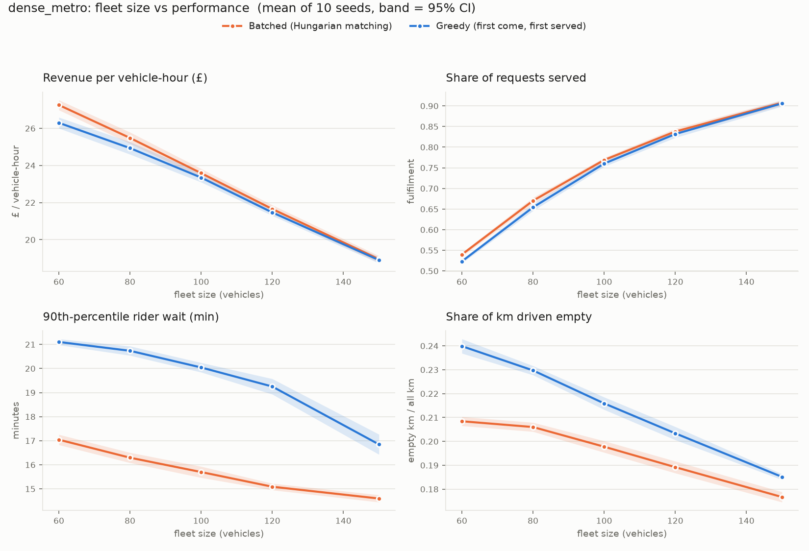
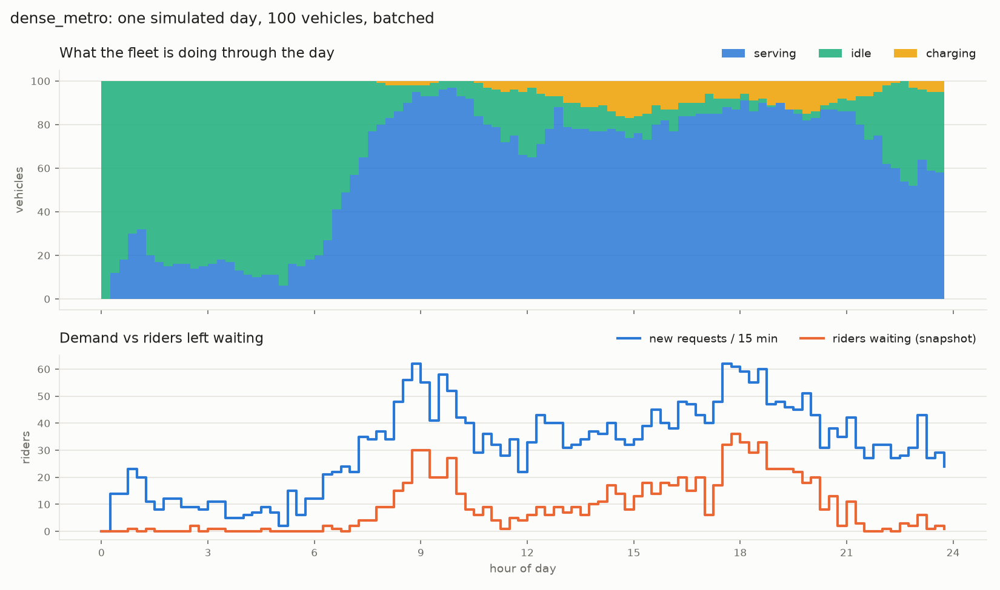
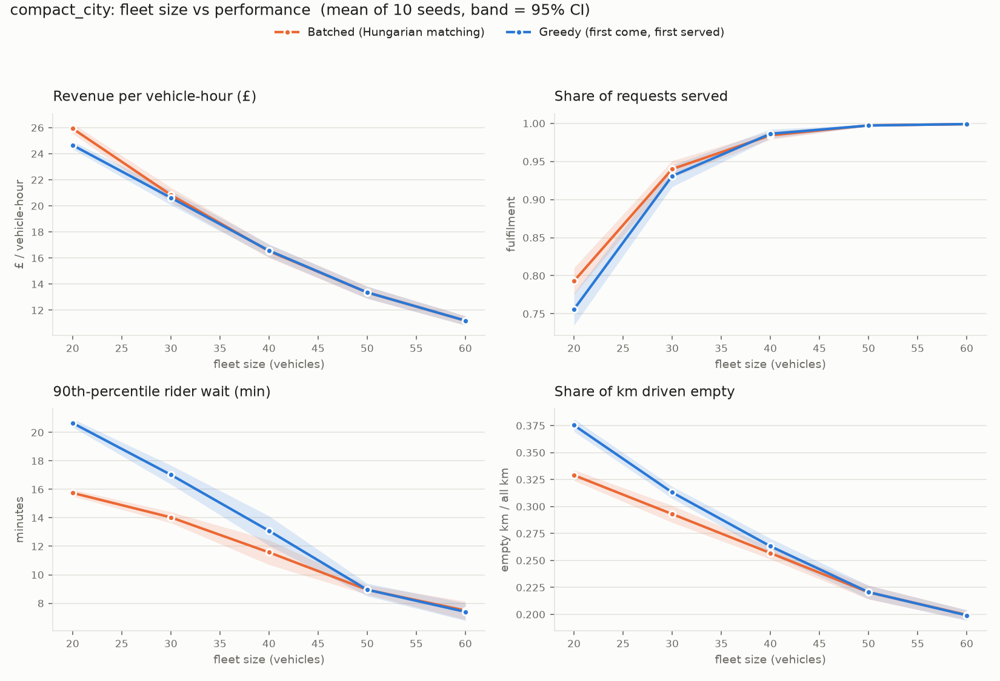

# UrbanFlow Fleet Sim - EV ride-hailing fleet simulator

A discrete-event simulation (SimPy) of an electric ride-hailing fleet: riders
request trips, a dispatcher matches them to cars, cars drive, drain their
batteries and queue at charging hubs. The point is to answer **"what happens
if...?"** questions - fleet size, dispatch policy, charger count, a new city -
*before* trying them on real vehicles.

> **Status:** v0.1 groundwork. All cities and numbers are **synthetic and
> illustrative** - the model is not yet calibrated to any real operator or city.
> Calibration against real trip data is the next milestone (see Roadmap).



---

## Why simulation (and not only prediction)

| | Question it answers | Example |
|---|---|---|
| **Prediction** (ML) | What will happen? | How many requests per zone at 08:00 Monday? |
| **Simulation** | What happens *under these conditions*? | With 100 cars and 20 chargers, how many riders wait > 15 min? |
| **Optimisation** | Which decision is best? | Which fleet size / dispatch rule maximises revenue per vehicle-hour at >= 85% service? |

They chain together: a demand forecast feeds the simulator, and an optimiser
(or an RL agent) searches over decisions by running the simulator many times.

## What the model contains

```
configs/*.yaml  ->  City (zones, demand by zone x hour, traffic speed by hour)
                     |
         +-----------+--------------------------------------------+
         | SimPy environment (one simulated clock)                |
         |   demand      NHPP arrivals via thinning               |
         |   patience    rider cancels after max_wait_min         |
         |   dispatcher  every 30 s: match waiting riders <-> idle cars
         |   serve       drive to pickup -> drive to drop-off      |
         |   charge      nearest hub, queue for a plug (Resource) |
         |   monitor     snapshot every 15 min                    |
         +--------------------------------------------------------+
                     |
                KPIs per run  ->  many seeds x scenarios (parallel)  ->  mean +/- 95% CI
```

**Vehicle states:** `idle -> to_pickup -> occupied -> idle`, and after a trip, if
battery < 20%: `to_charger -> charging -> idle`.

| Component | How it is modelled | Why |
|---|---|---|
| City | Square grid of zones; road km = grid distance x zone size x detour factor | Stand-in for H3 hexes + a road network; swappable |
| Demand | Non-homogeneous Poisson process. lambda(zone, hour) = daily x hourly share x zone weight. Generated by **thinning** | Arrivals are random but the *rate* changes through the day |
| Travel time | Distance / average speed of that hour (slower in peaks) | Congestion without a full traffic sim |
| Dispatch | `greedy`: oldest rider gets the nearest car. `batched`: Hungarian algorithm minimises total pickup time over everyone waiting | Compare a simple baseline with optimal matching |
| Constraints | A car is only offered a trip if battery covers pickup + trip + reaching a charger + reserve; pickups capped at 15 min | Never strand a car or send one across the city |
| Charging | Hubs are `simpy.Resource`s with N plugs; cars queue FIFO; charge 50 kW up to 80% | Charger congestion emerges by itself |
| Money | Fare = base + per km + per min; energy cost per kWh | Revenue and net revenue per vehicle-hour |

**Why discrete-event (SimPy) first?** Fleet operations are event-driven
(request, assign, pickup, drop-off, plug in). The clock jumps between events, so
a full day of 100-150 cars and about 3,000 requests runs in about 0.25 s on a laptop. That speed allows hundreds of
scenario runs. SUMO (road-level traffic) or Mesa (agent-based) become worth it
when road congestion or individual driver behaviour is the question - see Roadmap.

## KPIs

| KPI | Definition |
|---|---|
| `revenue_per_vehicle_hour` | total fares / (vehicles x hours) - the headline commercial metric |
| `net_per_vehicle_hour` | (fares - energy cost) / (vehicles x hours) |
| `fulfilment` | completed / (completed + cancelled) |
| `utilisation` | share of fleet time with a passenger on board |
| `empty_km_share` | km driven without a passenger (to pickups + chargers) / all km |
| `p90_wait_min` | 90th percentile of request -> pickup time |
| `mean_charger_queue_min` | average wait for a free plug |

## Results (synthetic `dense_metro`, 3,000 requests/day, 20 plugs, 10 seeds per point)

| Vehicles | Policy | £ / vehicle-hour | Served | P90 wait (min) | Empty km | Charger queue (min) |
|---:|---|---:|---:|---:|---:|---:|
| 60 | greedy | 26.30 | 52% | 21.1 | 24.0% | 0.2 |
| 60 | batched | **27.26** | 54% | **17.0** | **20.8%** | 0.3 |
| 100 | greedy | 23.35 | 76% | 20.0 | 21.6% | 1.8 |
| 100 | batched | **23.59** | 77% | **15.7** | **19.8%** | 1.8 |
| 150 | greedy | 18.90 | 91% | 16.8 | 18.5% | 6.2 |
| 150 | batched | 18.95 | 91% | **14.6** | **17.7%** | 4.0 |

Full table: [`results/dense_metro/summary.csv`](results/dense_metro/summary.csv).

**What it shows**

1. **There is no single "best" fleet size - it is a trade-off.** Going from 60 to
   150 cars raises the share of riders served from 54% to 91%, but revenue per
   vehicle-hour falls from about £27 to £19, because each car gets fewer trips. The right answer
   depends on the objective (earnings per car vs service level), which is a
   business decision. The simulator makes the trade-off visible.
2. **Smarter matching helps most when cars are scarce.** Batched (Hungarian)
   matching cut P90 wait by about 4 minutes (about 20%) at every fleet size and reduced empty
   km. Its revenue gain was +3.6% at 60 cars, shrinking to about 0 at 150 cars.
   In the smaller `compact_city`, at 40+ cars the two policies are
   indistinguishable: when supply is plentiful, the matching rule stops mattering.
3. **Charging becomes a bottleneck as the fleet grows.** With the same 20 plugs,
   average charger queueing rises from about 0.3 min (60 cars) to 4-6 min (150 cars):
   more cars need more chargers, not just more demand.
4. **Spatial mismatch is visible.** In the day timeline below, around midday some
   cars sit idle while riders still wait. The idle cars are in the wrong zones
   (beyond the 15-minute pickup cap). This motivates the next feature: **repositioning**
   idle cars toward predicted demand.



### Same simulator, different city (config only)

`configs/compact_city.yaml` describes a smaller city (8x8 zones, 1,100
requests/day, 8 plugs). No code changes - this is how a new city is added:



## Verification vs validation

* **Verification - "is the code right?"** `pytest` checks that same seed gives the same result,
  that event times are ordered (request <= assign <= pickup <= drop-off),
  that riders are matched within their patience, that batteries never go negative,
  that charger capacity is respected, that demand volume is within 4 sigma of the input,
  that the busiest hour matches the configured peak, and that Hungarian matching is never
  worse than greedy (200 random cases).
* **Validation - "is the model right?"** Not done yet - it needs real data.
  Plan: fit lambda(zone, hour) and speeds from historical trips, replay a held-out
  week, and compare simulated vs observed distributions (trip length, wait,
  revenue per hour) with KS / Wasserstein distance and KPI error (MAPE).

## Run it

```bash
python -m venv .venv && source .venv/bin/activate
pip install -e ".[dev]"

pytest -q                                                         # 10 tests
python scripts/run_day.py --vehicles 100 --policy batched --plot results/day.png
python scripts/run_scenarios.py --config configs/dense_metro.yaml --fleet-sizes 60 80 100 120 150 --seeds 10
python scripts/run_scenarios.py --config configs/compact_city.yaml --fleet-sizes 20 30 40 50 60
```

`foundations/` contains the first step of the project: a discrete-event scheduler
written by hand with a heap, next to the same model in SimPy. Both give
identical results, which shows what SimPy does internally.

## Project layout

```
fleetsim/
  config.py       YAML -> typed, immutable config; per-run overrides
  city.py         zones, demand intensity, distances, hourly speeds
  dispatch.py     greedy and Hungarian (batched) matching
  simulation.py   SimPy model + KPIs
  experiments.py  parallel scenario x seed grid, mean and 95% CI (Student t)
  plots.py        charts
configs/          one YAML per city scenario
scripts/          run_day.py, run_scenarios.py
tests/            verification tests
foundations/      hand-written event scheduler vs SimPy
```

## Roadmap

1. **Calibrate on real trips** (e.g. NYC TLC open data): fit lambda(zone, hour, weekday)
   and hourly speeds, then validate on a held-out week (see above).
2. **Repositioning policy:** send idle cars toward forecast demand. Measure the
   gain in revenue per vehicle-hour vs the extra empty km.
3. **New-city transfer:** build demand for a city with no trip history from
   proxies (population, employment, POIs, transit). Fit the proxy -> demand mapping on
   a city that *has* data, and quantify the transfer error.
4. **Smarter charging:** charge in off-peak troughs and pick hubs by queue length, not distance.
5. **RL:** wrap the simulator as a Gymnasium environment (state: zone, hour, battery,
   local supply/demand; action: stay / move / charge; reward: net revenue) and
   compare a learned repositioning policy with the heuristic.
6. **Road network:** OSMnx/H3 zones and network travel times. SUMO only if
   congestion feedback from the fleet itself matters.
7. **Scale-out:** containerise and run scenario grids on cloud batch jobs.
